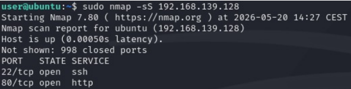
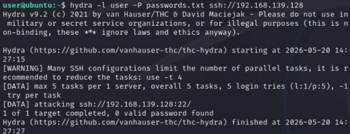
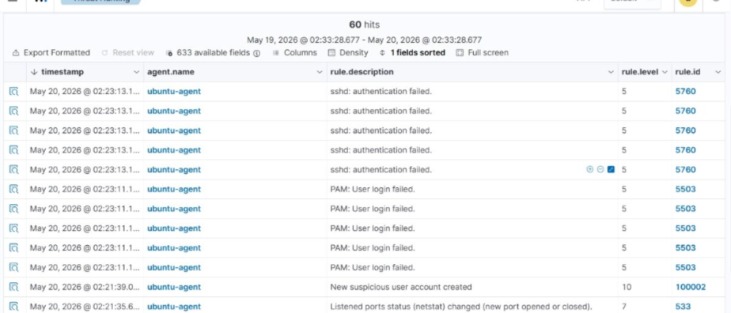

# Wazuh — SIEM & Detection Lab

Open-source SIEM deployment across a heterogeneous, multi-VM lab, built to verify
that Wazuh actually **detects** attacks end to end — not just that it collects logs.

## Overview

[Wazuh](https://wazuh.com/) was deployed as a standalone manager with agents enrolled
on Linux and Windows hosts, with centralized log collection. Two simulated attack
scenarios (network reconnaissance and SSH brute force) were run against a lab
target to generate real authentication and reconnaissance events, and one custom
detection rule was configured and validated against the dashboard.

This project is a direct companion to [`elastic-security-soc-lab`](https://github.com/Ryad-Cyber/elastic-security-soc-lab),
the same detection exercise built on the Elastic stack — see the **Wazuh vs.
Elastic** notes below for what each tool made easy or hard to configure.

## Objective

Verify, end to end, that an open-source SIEM deployed on a heterogeneous
infrastructure of several virtual machines genuinely detects attacks — not only
that it ingests logs.

## Environment & technologies

| Component | Detail |
|---|---|
| SIEM | Wazuh (manager + agents) |
| Virtualization | VMware, multiple VMs |
| Agent hosts | Linux, Windows |
| Attack tooling | Nmap (reconnaissance), Hydra (SSH brute force) |
| Target service | OpenSSH (port 22) |

## Architecture

```
┌─────────────┐        logs/events        ┌───────────────┐
│ Linux agent │ ─────────────────────────▶ │               │
└─────────────┘                            │ Wazuh manager │──▶ Dashboard / alerts
┌─────────────┐        logs/events        │               │
│Windows agent│ ─────────────────────────▶ └───────────────┘
└─────────────┘
       ▲
       │ Nmap scan, Hydra SSH brute force
┌─────────────┐
│ Attacker VM │
└─────────────┘
```

The Wazuh manager centralizes authentication and system events from both agents.
Attacks were launched from a separate VM against the Linux agent to generate
genuine telemetry rather than synthetic/sample data.

## What was actually done

1. Installed the Wazuh manager and deployed agents on Linux and Windows hosts,
   with centralized log collection.
2. Configured **one custom detection rule (ID `100002`, level 10)** to flag the
   creation of a suspicious user account — confirmed present and firing in the
   dashboard (see [screenshot 01](screenshots/01-dashboard-alerts.png)).
3. Ran an Nmap scan against the lab target to identify exposed services.
4. Ran an SSH brute-force attempt with Hydra against the identified SSH service,
   to generate authentication failures for Wazuh to pick up.
5. Reviewed the resulting events and alerts in the Wazuh dashboard.
6. Compared Wazuh's behaviour to Elastic Security on equivalent scenarios, to
   understand what each tool makes easy or difficult to configure.

## Detection scenarios

### 1. Network reconnaissance — Nmap scan

A TCP SYN scan (`nmap -sS <target>`) against the lab host identified two open
ports: `22/tcp (ssh)` and `80/tcp (http)`. This reconnaissance step corresponds
to **MITRE ATT&CK [T1046 — Network Service Discovery](https://attack.mitre.org/techniques/T1046/)**.



### 2. SSH brute force — Hydra

A Hydra dictionary attack (`hydra -l user -P passwords.txt ssh://<target>`) was
run against the SSH service identified above, to generate authentication
failures for Wazuh to detect. The attempt did not recover a valid password — the
objective was to produce the failed-login telemetry, not to compromise the host.
This technique corresponds to **MITRE ATT&CK [T1110 — Brute Force](https://attack.mitre.org/techniques/T1110/)**.



### 3. Resulting alerts in the Wazuh dashboard

The dashboard confirms that the brute-force attempt was picked up by Wazuh's
**default** detection rules — no custom rule was needed to catch it:

| Rule ID | Level | Description |
|---|---|---|
| `5760` | 5 | sshd: authentication failed |
| `5503` | 5 | PAM: User login failed |
| `100002` | 10 | New suspicious user account created *(custom rule, configured for this lab)* |

Rule `100002` is the only rule configured specifically for this lab; rules
`5760` and `5503` are Wazuh's built-in default rules, triggered automatically
by the failed SSH/PAM authentication attempts above.



## Results — verified

- Agents from two different operating systems reporting into a single Wazuh
  manager, confirming centralized log collection across a heterogeneous
  infrastructure.
- A simulated network scan and an SSH brute-force attempt both generated
  observable alerts in the Wazuh dashboard, confirming Wazuh detects attacks
  in practice, not only in configuration.
- A custom rule (`100002`, level 10) was configured and confirmed present and
  triggering in the dashboard.

## Configured vs. tested — what this lab does and does not claim

- **Configured and tested:** default SSH/PAM failed-authentication rules
  (`5760`, `5503`), triggered by the Hydra brute-force attempt.
- **Configured and confirmed in the dashboard:** the custom rule `100002`
  (suspicious account creation). The exact rule definition (XML) was not kept
  outside the lab environment, so this repository documents it as observed in
  the dashboard rather than reproducing its configuration file.
- **Not claimed:** no production deployment, no long-term monitoring, and no
  Wazuh-native MITRE ATT&CK tagging — the ATT&CK references above are this
  write-up's own mapping of the attacker techniques used, not metadata
  produced by Wazuh itself.

## Wazuh vs. Elastic Security

Both tools were used to work through comparable detection scenarios. Wazuh's
agent-based model centralizes log collection and ships default authentication
rules out of the box, which made catching the SSH brute force straightforward
without extra rule-writing. Elastic Security (see
[`elastic-security-soc-lab`](https://github.com/Ryad-Cyber/elastic-security-soc-lab))
required writing detection rules from scratch (KQL/EQL) but gave finer control
over query logic and investigation workflow. Neither comparison claims one
tool is categorically better — they make different tradeoffs between
out-of-the-box coverage and customization effort.

## Skills demonstrated

- Wazuh manager and agent deployment across heterogeneous operating systems.
- Centralized log collection design across multiple VMs.
- Writing and validating a custom Wazuh detection rule.
- Attack simulation for detection validation (Nmap reconnaissance, Hydra
  brute force).
- Reading and interpreting SIEM alert data (rule ID, severity level,
  description).
- Comparative evaluation of two SIEM platforms (Wazuh, Elastic Security) on
  equivalent scenarios.

## Limitations

- This is an academic/personal lab exercise, not a production deployment —
  no long-term retention, scaling, or alert-fatigue tuning was evaluated.
- The custom rule's XML definition was not preserved outside the lab
  environment; only its observed behaviour in the dashboard is documented
  here.
- Only two scenarios (network scan, SSH brute force) were exercised; broader
  attack coverage (e.g. persistence, lateral movement) was not tested in this
  lab.

## Portfolio

Full write-up and context: [ryad-cyber.github.io](https://ryad-cyber.github.io/#p-wazuh)
